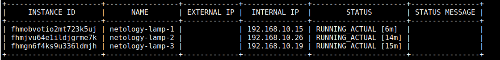
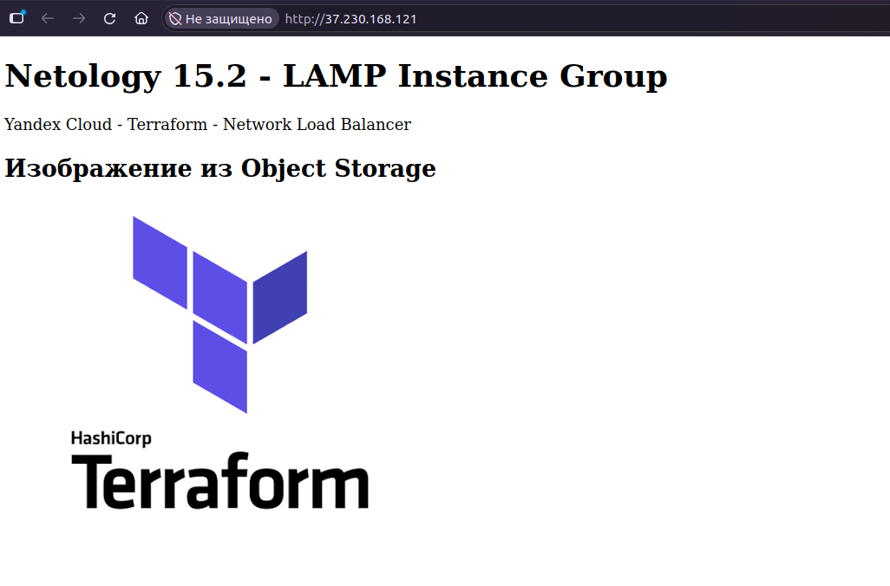

# Домашнее задание 15.2 — Вычислительные мощности. Балансировщики нагрузки

## Задание 1. Yandex Cloud

Инфраструктура развёрнута с помощью Terraform.

Реализованы:
- Object Storage с публичным изображением.
- Instance Group из трёх виртуальных машин LAMP.
- Network Load Balancer.
- Автоматическое восстановление виртуальных машин.

## 1. Object Storage

Создан бакет `pfccska777-netology-15-2-20261116`.

В него загружено изображение `image.jpg`, доступное по публичной ссылке:

https://storage.yandexcloud.net/pfccska777-netology-15-2-20261116/image.jpg

Проверка `curl -I` вернула `HTTP/2 200`.

## 2. Instance Group

Создана группа `netology-lamp-ig` из трёх виртуальных машин.

**Параметры каждой машины:**
- Образ: LAMP (`fd827b91d99psvq5fjit`).
- 2 vCPU с гарантированной долей 20%.
- 2 ГиБ RAM.
- 20 ГиБ HDD.
- Зона доступности: `ru-central1-a`.

Используется существующая сеть из домашнего задания 15.1.

Через `cloud-init` на каждой машине создаётся веб-страница с изображением из Object Storage.

## 3. Network Load Balancer

Создан балансировщик `netology-lamp-nlb`, распределяющий HTTP-запросы между тремя серверами.

**Адрес работающего сайта во время проверки:**

http://37.230.168.121

Проверка `curl -I` вернула `HTTP/1.1 200 OK`.

Все три сервера успешно проходят
